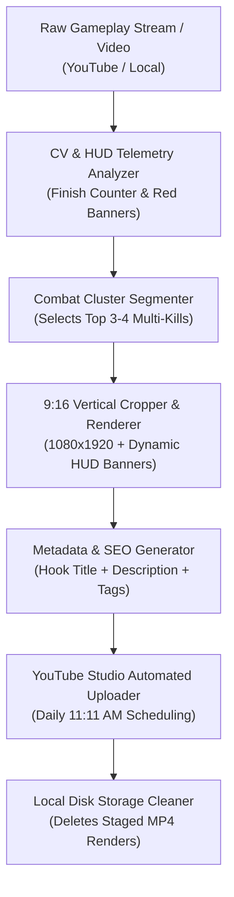

# Automate-Yt 🎬⚡

> **Automated AI-Driven YouTube Shorts Production Pipeline for Gaming & Esports Channels**

[](https://www.python.org/)
[](https://opensource.org/licenses/MIT)
[]()
[]()

---

## 📌 Overview

**Automate-Yt** is an end-to-end automation suite designed to transform raw, long-form competitive gaming broadcasts (e.g. ScarFall 2.0, BGMI, PUBG Mobile) into viral, high-retention **9:16 Full Screen (1080×1920) YouTube Shorts**.

The pipeline automatically analyzes gameplay video, pinpoints combat sequences via computer vision and HUD telemetry, stitches together **3–4 high-intensity kills** into a seamless montage, adds dynamic HUD indicators, generates SEO-optimized metadata, and stages or schedules uploads to YouTube Studio daily at **11:11 AM**.

---

## 🚀 Key Features

- **🎯 Multi-Kill Frag Merger**: Automatically cuts out running and looting downtime, chaining 3–4 pro-level tournament eliminations (against top rosters like Cloud9, KyZN, ESPD) into an intense ~30-second Short.
- **👁️ Computer Vision & OCR HUD Telemetry**: Detects active combat by scanning the `Finish: X` counter, crosshair hitmarkers, and middle-screen elimination medals (`Double Finish`, `Super Duper Rock n' Roll`).
- **📱 True 9:16 Full Screen Dynamic Cropping**: Seamlessly adapts 20:9 ultrawide and 16:9 source footage into 1080×1920 vertical format without black bars or blurry letterboxing.
- **🏷️ Dynamic HUD Counter Badges**: Burns in sleek top badges (`KILL 1 & 2 - vs CLOUD9`, `KILL 3 - 6X LASER BEAM`, `FINAL 1v1 - CLUTCH WIN!`) to guide viewer attention.
- **⏰ Daily 11:11 AM Automated Cadence**: Schedules daily uploads at peak viewer hours.
- **💾 Auto Local Storage Management**: Automatically prunes rendered duplicate `.mp4` files from local storage post-upload to conserve hard disk space.

---

## 🏗️ Architecture



---

## 📁 Repository Structure

```text
Automate-Yt/
├── .gitignore                      # Prevents committing heavy video binaries or temporary frames
├── README.md                       # Complete documentation & usage guide
├── requirements.txt                # Python package dependencies
├── config/
│   ├── config.yaml                 # Channel settings, scheduling time, video presets
│   └── voice.md                    # Channel tone, pacing, banned words, formatting rules
├── src/
│   ├── analyzer/                   # Combat detection and HUD scanning modules
│   │   ├── detect_fights.py        # Audio energy and motion-based fight detection
│   │   ├── fast_killfeed_detect.py # High-speed sequential finish counter scanner
│   │   ├── find_all_kills.py       # Full-match kill badge locator
│   │   ├── inspect_ui.py           # HUD bounding box coordinate analyzer
│   │   ├── map_kills.py            # Timestamps cluster mapper
│   │   └── track_kills.py          # Score increment tracker
│   ├── editor/                     # Video editing and 9:16 compilation modules
│   │   ├── create_short.py         # Single-clip 9:16 extractor
│   │   └── multi_kill_merge.py     # 3-4 Kills montage builder with HUD badges
│   ├── channel/                    # Channel exploration and catalog scrapers
│   │   ├── explore_channel.py      # Video scraper using yt-dlp
│   │   └── analyze_catalog.py      # Long-form video analyzer
│   └── uploader/                   # YouTube metadata packaging modules
│       └── metadata_generator.py   # SEO titles, descriptions, and hashtags generator
├── scripts/
│   └── run_daily_pipeline.py       # Master end-to-end runner script
└── metadata/                       # Production ledger records of scheduled Shorts
    ├── tournament_4kills_montage_metadata.json
    ├── squad_wipe_916_short_metadata.json
    ├── room_clutch_916_metadata.json
    ├── kyzn_rock_clash_metadata.json
    ├── final_1v1_clutch_metadata.json
    └── espd_laser_metadata.json
```

---

## 🛠️ Installation & Setup

### Prerequisites
- **Python 3.10+**
- **FFmpeg** installed and added to system `PATH`
- **yt-dlp** for fetching source broadcasts

### Install Dependencies
```bash
git clone https://github.com/Kanhaiyaji/Automate-Yt.git
cd Automate-Yt
pip install -r requirements.txt
```

---

## ⚡ Quick Start

### 1. Merge 3–4 Tournament Kills into a 9:16 Short
```bash
python src/editor/multi_kill_merge.py --source path/to/gameplay.mp4 --output out/multikill_916.mp4
```

### 2. Scan a Match for All Kill Moments
```bash
python src/analyzer/fast_killfeed_detect.py --source path/to/gameplay.mp4
```

### 3. Run the Master Daily Pipeline
```bash
python scripts/run_daily_pipeline.py --source path/to/gameplay.mp4 --date 2026-10-25 --time "11:11 AM"
```

---

---

## 📜 License
This project is licensed under the MIT License - see the [LICENSE](LICENSE) file for details.
